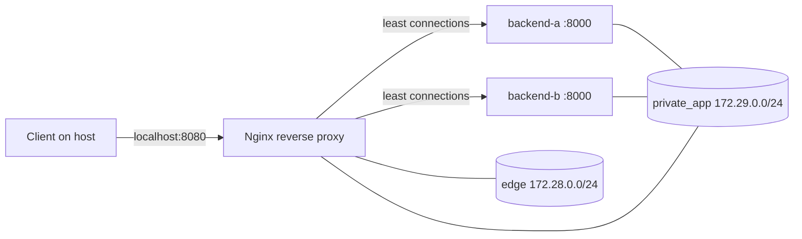

# Cloud Networking Lab

A runnable networking playground for backend, ML-platform and cloud-system interviews. It demonstrates the network primitives that sit underneath AWS VPC, GCP VPC, Azure VNet and Huawei VPC terminology instead of treating cloud networking as a list of vendor products.

## What runs



The backend containers are intentionally attached only to the internal `private_app` Docker network. The proxy is dual-homed: it receives traffic from the edge network and forwards it to private services. This mirrors the public-load-balancer/private-compute pattern used in cloud deployments.

## Quick start

```bash
docker compose up --build
curl http://localhost:8080/whoami
python tools/load_demo.py --requests 200 --concurrency 32
python tools/network_probe.py http://localhost:8080/whoami
```

Repeated `/whoami` calls expose the selected backend so load balancing is observable. `load_demo.py` reports backend distribution, throughput and p50/p95/p99 latency.

## Failure experiments

While the stack is running:

```bash
docker compose stop backend_a
python tools/load_demo.py --requests 50 --concurrency 8

docker compose start backend_a
```

This makes proxy retry/failover behavior visible. The Nginx config uses connection/read timeouts, upstream fail counters and bounded `proxy_next_upstream` retries rather than infinite retry behavior.

## Hands-on labs

| Lab | Demonstrates |
|---|---|
| `01_cidr.py` | IPv4 networks, CIDR membership and subnet splitting |
| `02_tcp_echo.py` | TCP sockets, listening ports, connection establishment and byte streams |
| `app/backend.py` | HTTP application behind a proxy; forwarded headers and instance identity |
| `nginx.conf` | Layer-7 reverse proxy, least-connection balancing, keep-alive and timeout policy |
| `tools/network_probe.py` | DNS resolution → TCP connect → HTTP request timing |
| `tools/load_demo.py` | concurrency, throughput, latency percentiles and backend distribution |
| `tools/connection_limiter.py` | non-queuing listener concurrency leases and low-cardinality saturation metrics |
| `tools/listener_admission.py` | composed capacity + PROXY v2 boundary with privacy-reduced audit evidence |
| `docs/graceful_listener_drain.md` | bounded, fail-closed listener draining for rolling deployments |
| `tools/proxy_v2.py` | strict, deadline-aware PROXY v2 admission before application parsing |
| `tools/replay_guard.py` | bounded, thread-safe TTL claims for PROXY unique-ID replay rejection |
| `docs/proxy_v2_replay_guard.md` | replay threat model, sizing and multi-process boundary |
| `tools/sqlite_replay_guard.py` | atomic local-worker replay claims with a persistent clock watermark |
| `docs/sqlite_replay_guard.md` | SQLite transaction, clock rollback and deployment boundaries |
| `tools/redis_replay_guard.py` | fleet-wide atomic replay claims with token-bound retries and optional replica acknowledgement |
| `tools/redis_promotion_proof.py` | signed epoch/offset freshness gate for promoted Redis replay traffic |
| `tools/redis_promotion_authority.py` | hash-chained election ledger, proof issuer and serialized epoch-write fence |
| `tools/redis_sentinel_promotion.py` | fail-closed live Sentinel election adapter with multi-observer corroboration |
| `tools/redis_failover_drill.py` | loopback-only stale-replica promotion fault injection with JSON evidence |
| `tools/docker_egress_partition.py` | bounded iptables controller with verified rollback for one-way peer isolation |
| `tools/docker_netem_impairment.py` | verified delay/reordering/loss policy, pinned queue limit and PRNG seed, runtime provenance, traffic counters, and cleanup |
| `tools/network_latency_evidence.py` | bounded baseline/impairment/recovery RTT evidence with aggregate-only receipts |
| `tools/network_loss_evidence.py` | bounded partial-loss probe outcomes and a 99% Wilson packet-frequency sanity check |
| `tools/compare_network_loss_evidence.py` | runtime-compatible retained benchmark regression gate with privacy-reduced evidence |
| `tools/authorize_network_loss_baseline.py` | Ed25519-reviewed baseline selection and protected-workflow comparison gate |
| `tools/network_loss_selector_key_status.py` | independently signed selector-key freshness and revocation status |
| `tools/network_loss_release_epoch.py` | authenticated release time bound to one exact netem gate |
| `tools/archive_network_loss_release.py` | content-addressed S3 Object Lock publication for accepted netem releases |
| `tools/redis_sentinel_election_drill.py` | three-Sentinel partition, impaired healing and stale-head fence drill |
| `docs/redis_replay_guard.md` | Redis Cluster slotting, same-connection `WAIT`, durability and failover boundaries |
| `docker-compose.yml` | edge/private network segmentation and service discovery by DNS name |

## Interview map

Be able to explain these mappings, not merely memorize them:

- **CIDR / subnet** — address-space boundaries and route domains.
- **Route table** — longest-prefix destination routing decision.
- **NAT** — private clients initiate outbound sessions while remaining unreachable as public endpoints.
- **DNS** — name-to-address resolution and service discovery; Docker DNS here plays the same conceptual role as managed/private DNS in cloud platforms.
- **Security group vs NACL** — stateful resource/interface firewall vs stateless subnet-level ACL in AWS terminology.
- **Reverse proxy vs load balancer** — both can distribute requests; managed cloud load balancers additionally integrate health, TLS, autoscaling and network control planes.
- **ALB vs NLB** — Layer 7 HTTP routing versus Layer 4 TCP/UDP/TLS behavior.
- **TLS termination** — decrypt at the edge or propagate TLS end-to-end depending on trust boundaries.
- **Timeouts/retries** — a reliability policy that must be bounded to avoid retry storms.
- **Private endpoint** — reach managed services without routing traffic through a public internet path.

## Useful commands while the stack is running

```bash
docker compose exec proxy getent hosts backend_a backend_b
docker compose exec proxy cat /etc/resolv.conf
docker network inspect cloud-networking-lab_private_app
curl -v http://localhost:8080/whoami
```

## Quality gates

GitHub Actions runs Ruff, pytest, Docker Compose validation, a live three-Sentinel healing drill and a container build. Every netem policy pins and verifies a 1,000-packet queue limit so host defaults cannot silently change queueing or drop behavior. The drill fails closed unless qdisc packet, byte, drop and overlimit counters are valid and monotonic, traffic crossed the active impairment, the configured delay is visible in aggregate round-trip latency, and latency returns to a bounded baseline band after cleanup. After healing, a separate 100% loss profile must block three bounded Redis probes, record at least three sent-plus-dropped packet attempts and a nonzero drop delta, then restore connectivity after verified qdisc cleanup.

The final benchmark applies independent 20% random loss with an explicit netem seed and a fixed 10 ms delay, runs 128 Redis probes under a 30-second budget, and requires both forwarded and dropped packet evidence. It also requires the configured rate to fall inside a two-sided 99% Wilson interval over qdisc packet attempts. Immediately before installing the policy, the controller records bounded canonical kernel-release and `tc`/iproute2 version strings, hashes each value, and commits both hashes into a schema-v1 runtime fingerprint. Schema-v9 drill evidence embeds only those digests alongside bounded probe outcome counts, duration, qdisc aggregates, the reviewed seed and interval; it does not retain host versions, endpoints, payloads, or individual timings.

The runtime fingerprint makes cross-run environment drift visible; it does not prove that two kernels implement netem identically or that the packet sequence is equivalent. A seed makes netem's random sequence reproducible only for a compatible implementation and equivalent packet sequence. TCP retransmission, scheduling and connection state can still change that sequence, so this is a controlled regression benchmark rather than a production SLO or a claim that application failure rate should equal packet-loss rate. The project is intentionally small enough to reason about packet flow at a whiteboard but complete enough to reproduce the topology locally.

Extract two retained `partial_loss_benchmark` objects and compare them only after their exact
runtime fingerprints and experiment policies match:

```bash
jq '.partial_loss_benchmark' baseline-drill.json > baseline-benchmark.json
jq '.partial_loss_benchmark' candidate-drill.json > candidate-benchmark.json

python -m tools.compare_network_loss_evidence \
  baseline-benchmark.json candidate-benchmark.json \
  --max-failure-rate-increase-basis-points 250 \
  --max-elapsed-increase-basis-points 2000 \
  --output benchmark-comparison.json
```

The loader rejects final-path symlinks, duplicate JSON keys, unknown fields, malformed runtime
commitments, and self-consistent-looking statistical substitutions by recomputing the observed
drop rate and 99% Wilson interval. Comparison then requires the same kernel/toolchain fingerprint,
configured loss, seed, probe count, and confidence level. Exit code `0` admits the candidate, `3`
records a valid but over-budget regression, and `2` rejects incomparable or malformed evidence.
The private comparison receipt contains source and policy commitments plus bounded deltas, not raw
runtime versions, endpoints, payloads, or individual timings.

Matching digests establish input compatibility, not semantic equivalence between kernels or
identical packet sequences. The default budgets allow a 2.5 percentage-point failure-rate increase
and a 20% elapsed-time increase; deployments should review and pin budgets appropriate to their
test stability before treating the result as a release gate.

For a protected release workflow, require a reviewer-selected baseline instead of invoking the
diagnostic comparator directly. A protected signer calls `create_baseline_authorization` with the
validated baseline, reviewed budgets, repository ID, exact workflow commit, bounded validity
window, Ed25519 public key and signing callback. The returned canonical envelope contains the
baseline, runtime and experiment-policy commitments; it never contains the private key.

A separate status authority calls `create_selector_key_status` with the exact selector key ID and
public-key digest, an `active` or `revoked` state, a maximum 24-hour validity window, and its own
Ed25519 signing callback. The authority key must be cryptographically distinct from the selector
key. Store the resulting status envelope beside the baseline authorization; pin both public-key
digests and both key IDs outside the artifacts.

After the candidate artifact is final, a third, independent release authority calls
`create_release_epoch` with the canonical authorization and status digests, exact baseline and
candidate digests, repository ID, workflow commit and asserted UTC release time. Its Ed25519 key and
key ID must be distinct from both selector roles and pinned outside the statement. This turns time
into an authenticated, input-bound release decision instead of a caller-selected CLI value.

```bash
python -m tools.authorize_network_loss_baseline \
  baseline-authorization.json selector-key-status.json release-epoch.json \
  baseline-benchmark.json candidate-benchmark.json \
  --selector-key-id netem-baseline-review-2026-11 \
  --selector-public-key-sha256 "$NETEM_BASELINE_SELECTOR_PUBLIC_KEY_SHA256" \
  --status-authority-key-id netem-selector-status-2026-11 \
  --status-authority-public-key-sha256 "$NETEM_SELECTOR_STATUS_PUBLIC_KEY_SHA256" \
  --release-authority-key-id netem-release-epoch-2026-11 \
  --release-authority-public-key-sha256 "$NETEM_RELEASE_AUTHORITY_PUBLIC_KEY_SHA256" \
  --repository-id 1330973695 \
  --workflow-sha "$GITHUB_SHA" \
  --max-failure-rate-increase-basis-points 250 \
  --max-elapsed-increase-basis-points 2000 \
  --output authorized-benchmark-comparison.json
```

The gate pins the Ed25519 public key out of band, verifies the signature before trusting signed
claims, enforces a maximum 24-hour authorization lifetime, and requires an exact match for the
baseline digest, runtime fingerprint, experiment policy, budgets, repository and workflow commit.
It then verifies the independently pinned status authority, exact selector identity, bounded status
freshness and `active` state before any comparison. Revoked, expired, future, substituted, or
self-authorized status fails closed. Before those freshness checks, the gate verifies that the
independently pinned release authority signed the exact authorization, status, baseline, candidate,
repository and workflow binding, then uses only that signed release time. Only then does it run the
existing compatibility and regression checks. Exit code `0` admits the candidate, `3` retains an
authenticated over-budget result, and `2` rejects untrusted, stale, malformed or mismatched inputs.
The private receipt retains release, status, authorization, source, policy and workflow commitments
plus bounded deltas—not key IDs, repository ID, workflow commit, signatures, raw public keys,
runtime versions or probe samples.

For durable evidence, run the archive command only from a protected release environment with an
AWS role scoped to one dedicated bucket and prefix. The command re-runs the complete authenticated
gate before creating an AWS client, refuses over-budget releases, checks versioning, Object Lock,
and all four bucket public-access blocks, then writes one canonical content-addressed bundle. It
uses a conditional create, a caller-pinned bucket owner, SHA-256 transport checksum, a caller-pinned
KMS key ARN, and per-object `COMPLIANCE` retention. Finally, it reads the exact returned version's
size, checksum, mode, and retention timestamp before emitting a privacy-reduced local receipt.

```bash
python -m tools.archive_network_loss_release \
  baseline-authorization.json selector-key-status.json release-epoch.json \
  baseline-benchmark.json candidate-benchmark.json \
  --selector-key-id netem-baseline-review-2026-11 \
  --selector-public-key-sha256 "$NETEM_BASELINE_SELECTOR_PUBLIC_KEY_SHA256" \
  --status-authority-key-id netem-selector-status-2026-11 \
  --status-authority-public-key-sha256 "$NETEM_SELECTOR_STATUS_PUBLIC_KEY_SHA256" \
  --release-authority-key-id netem-release-epoch-2026-11 \
  --release-authority-public-key-sha256 "$NETEM_RELEASE_AUTHORITY_PUBLIC_KEY_SHA256" \
  --repository-id 1330973695 \
  --workflow-sha "$GITHUB_SHA" \
  --bucket private-netem-release-archive \
  --expected-bucket-owner 123456789012 \
  --kms-key-arn \
    arn:aws:kms:eu-central-1:123456789012:key/12345678-1234-1234-1234-123456789abc \
  --aws-region eu-central-1 \
  --retention-days 365 \
  --output release-archive-receipt.json
```

The S3 bucket must have versioning and Object Lock enabled at creation time, with bucket-level
public access fully blocked. The release role needs only the bucket-control reads, object create,
exact-version attribute/retention reads, and KMS encryption permissions required by this flow;
deny unencrypted writes and writes outside the configured prefix in bucket policy. Keep delete,
retention changes, bucket administration, and KMS administration out of the release role. Test
policy and retention settings in a disposable account first: S3 Object Lock `COMPLIANCE` retention
cannot be shortened or bypassed, including by the root user.

This is a release authorization and immutable-retention boundary, not key custody, trusted hardware
time, authority quorum, cross-account replication, or public artifact transparency. The signature
authenticates which release authority asserted the epoch; it cannot prove that authority's clock
was correct. The protected workflow must still separate all three signing roles from the archive
role. Threshold-signed status and transparent publication remain future hardening steps.


