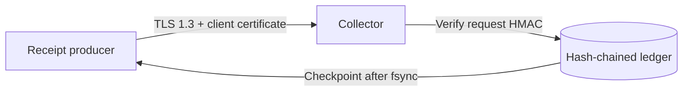

# mTLS receipt transport

The authenticated receipt ledger protects append intent and retained history, but an HMAC does not
encrypt the receipt in transit or prove that the producer reached the intended collector. The
`tools.proxy_v2_mtls_transport` module adds that network boundary without changing the ledger
format.



## Security contract

Both peers authenticate the connection before a receipt is processed:

- the producer validates the collector CA chain, DNS name, and an explicit SHA-256 certificate
  fingerprint rotation set;
- the collector requires a client certificate signed by its configured CA and checks the client
  fingerprint against its own rotation set;
- both contexts require TLS 1.3, peer verification, and compression disabled;
- private-key paths must be regular, non-symlinked files without group or world permissions;
- one monotonic deadline covers handshake, the request frame, append response, and partial reads;
- frames use a four-byte network-order length and are capped at 32 KiB before JSON parsing;
- envelopes and responses must be canonical JSON with exact fields, no duplicates, and no
  non-finite values.

The request HMAC remains necessary. mTLS authenticates a connection, while the request HMAC binds
the complete receipt, producer nonce, and expected ledger head into replay/stale-head enforcement.
The collector checks the client certificate before reading the application frame and invokes the
existing ledger append only after the framed request passes strict parsing.

## Library use

Create contexts from managed-PKI files and pass certificate fingerprints through deployment
configuration. A rotation can temporarily contain both the retiring and replacement certificate:

```python
from pathlib import Path

from tools.proxy_v2_mtls_transport import (
    build_client_context,
    build_server_context,
    collect_one_append,
    deliver_append_request,
)

client_context = build_client_context(
    ca_file=Path("/run/pki/collector-ca.pem"),
    certificate_file=Path("/run/pki/producer.pem"),
    private_key_file=Path("/run/pki/producer.key"),
)
checkpoint = deliver_append_request(
    "collector.internal",
    9443,
    server_hostname="collector.internal",
    context=client_context,
    trusted_server_certificate_sha256={current_server_pin, next_server_pin},
    receipt=receipt,
    request=append_request,
    timeout_seconds=5.0,
)

server_context = build_server_context(
    ca_file=Path("/run/pki/producer-ca.pem"),
    certificate_file=Path("/run/pki/collector.pem"),
    private_key_file=Path("/run/pki/collector.key"),
)
result = collect_one_append(
    listening_socket,
    context=server_context,
    trusted_client_certificate_sha256={current_client_pin, next_client_pin},
    ledger_path=Path("/var/lib/collector/receipts.jsonl"),
    request_key=request_hmac_key,
    checkpoint_key=checkpoint_hmac_key,
    expected_payload=expected_application_frame,
    timeout_seconds=5.0,
)
```

`collect_one_append` deliberately handles one accepted socket. A service supervisor should own the
listen/backlog policy, concurrency limit, shutdown behavior, metrics, and repeated accept loop.
This keeps transport admission separate from process orchestration.

After the ledger append and `fsync`, the collector returns the authenticated checkpoint over the
TLS connection. The producer recomputes the expected new chain head from its receipt, request,
previous head, and returned sequence before accepting that checkpoint. Policy failures such as a
stale head are detailed only in the collector-local `CollectorResult`; the producer receives the
stable `append_rejected` code, avoiding a remote ledger-state oracle.

## Validation

The tests generate a disposable CA, server certificate, and client certificate at runtime with
OpenSSL. No certificate or private key is committed. They exercise a real TLS 1.3 loopback and
cover successful append/checkpoint verification, stale-head rejection, server and client pin
mismatches, hostname validation, insecure-context refusal, private-key permissions, oversized
frames, and duplicate response fields.

## Deliberate limits

- This module provides a bounded transport primitive, not certificate issuance, renewal, or a
  long-running collector daemon. Production needs managed PKI and audited identity enrollment.
- Pins cover the complete leaf certificate, not its public key, so every certificate renewal must
  be staged through the rotation set (maximum eight pins).
- A successful append followed by a lost response is ambiguous. Retrying the same nonce is safely
  rejected; the producer must reconcile against an externally retained checkpoint/head rather than
  inventing a new append.
- The returned checkpoint is protected by the collector's HMAC and the TLS session. Independent
  verification still requires the checkpoint key or a separately trusted external anchor.
- File permission checks cannot remove the path-to-load race in OpenSSL's certificate APIs. Mount
  private keys read-only from a secret manager and constrain the collector account.
- Python's system DNS resolution happens before the socket timeout can be enforced. Production
  name resolution therefore needs its own bounded, observable resolver policy.
- mTLS protects transport, not the collector host. The local ledger remains replaceable by an
  administrator and is not immutable or outside the collector failure domain.

The next increment is to place the collector behind a least-privilege service identity, persist the
append in independently administered immutable storage, and anchor returned checkpoints outside
the collector account.
